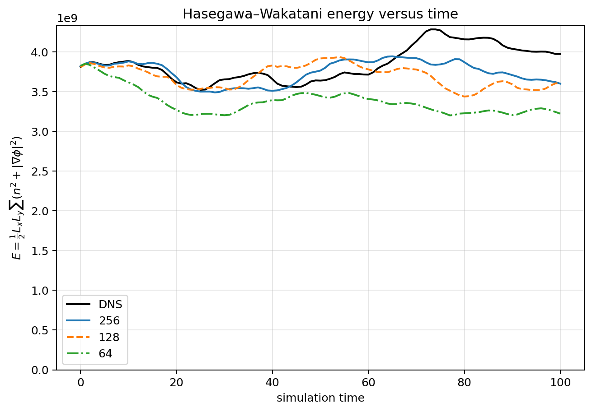
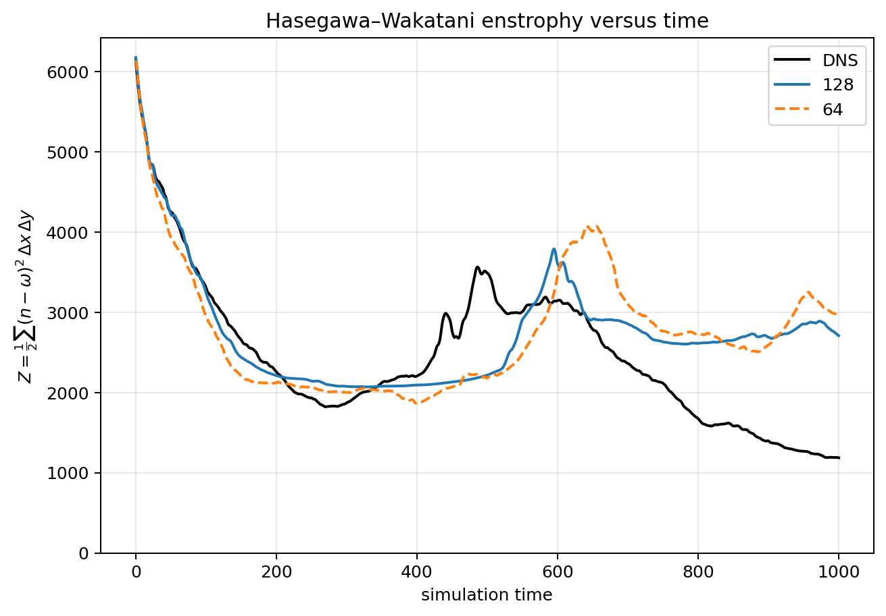
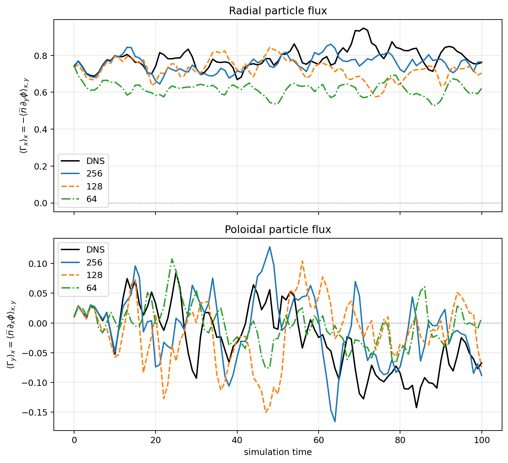

# Germano U-Net for Hasegawa--Wakatani

This project shows the use of Germano's filter combined to U-Net and BOUT++
for accelerating Hasegawa-Wakatani simulations.

## Reproduce the results

Two routes lead to the same BOUT++ time-integration workflow:

1. **Faster: use pretrained weights.** Download a matching checkpoint from
   [Zenodo (DOI: 10.5281/zenodo.22973917)](https://doi.org/10.5281/zenodo.22973917),
   then run the coupled solver as described in [Option 1](#option-1-pretrained-weights-and-bout-time-integration).
2. **Train your own model.** Train on DNS snapshots, inspect the learning curves
   with `plot_tensorboard.py`, check one snapshot with `infer_germano_unet.py`,
   and use the resulting checkpoint in the same solver workflow. See
   [Option 2](#option-2-train-check-and-integrate).

The worked example below is **HW, DNS 512² → LES 128²**, using the model and
source and input template in `BOUT_runs/HW_template`. Run commands from the repository root
unless a subshell explicitly changes directory.

### Environment and inputs

Use Python 3.10 or newer with PyTorch, NumPy, Matplotlib, TensorBoard, Pillow
and netCDF4. For example, in a Python environment of your choice:

```bash
python -m pip install torch numpy matplotlib tensorboard pillow netCDF4
export UNET_ROOT="$PWD"
```

For CUDA runs, use a PyTorch build compatible with your machine's CUDA runtime.
For coupled runs, set `device = cpu` in the `[unet]` section of the run’s
`data/BOUT.inp`. Standalone inference selects CUDA when available, otherwise CPU.

**Time integration requires an installed or already built BOUT++ library**,
its CMake package (`bout++Config.cmake`), a compatible C/C++ compiler and MPI
installation, and Python development headers/library. Training and standalone
snapshot inference do not require BOUT++. The executable built here embeds
Python and imports **`pBOUT-unet.py`** (hyphen, not `pBOUT_unet.py`); do not
launch that callback module as a standalone simulation script.

You also need a DNS initial condition matching the checkpoint's physical case,
fine-grid resolution and domain. The worked example uses
`fields/fields_HW_run0_time381_N512.npz`. Snapshots store `U` (density), `V`
(potential) and `P` (vorticity). The pretrained weights alone are not initial
conditions or a training dataset. If the snapshot is absent from your checkout,
obtain the matching DNS snapshot before running this example.

### Option 1: pretrained weights and BOUT++ time integration

#### Download and select weights

Download and extract the weights from the
[Zenodo record](https://doi.org/10.5281/zenodo.22973917). Select the **HW,
`fine_n=512`, `coarse_n=128`** checkpoint for this example. Set its actual local
path in the `[unet]` section of each run’s `data/BOUT.inp`; the example does
not assume a particular archive layout. Use absolute paths here, not shell variables.

```ini
[unet]
checkpoint = /absolute/path/to/downloaded/HW_dns512_les128/best.pt
dns_path = /absolute/path/to/U-Net-LES/fields/fields_HW_run0_time381_N512.npz
```

The checkpoint supplies architecture, domain lengths, Germano filter width,
normalization and inverse-filter settings. Keep those defaults for the first
run; do not apply overrides copied from a different training experiment. The
startup log reports the effective configuration. In this example the domain
is `Lx=Lz=50.176`; the Germano filter width is distinct from the physical
adiabaticity parameter `[hw] alpha=1.0` in `BOUT.inp`.

#### Compile the coupled model

From the repository root, compile HW into a separate run directory:

```bash
cd BOUT_runs/
bash HW_template/build.sh HW_N256
```

The run directory argument is required. This creates `BOUT_runs/HW_N256`
with an unchanged copy of `HW_template/data/BOUT.inp` and the compiled
executable in `build_release/`. The directory name does not select the grid size.
Generated run files are ignored by Git; `HW_template` contains the
version-controlled source and input template. Existing run inputs are preserved.

The default BOUT++ location is **`../BOUT-dev` relative to this repository**;
it must already be built. The script activates the cluster's `BOUT-Hermes3`
environment when available and uses the compilers from the BOUT++ build cache.
Set `BOUT_ROOT` to select another BOUT++ installation or build tree.
Set grid sizes and all other simulation parameters directly in `BOUT.inp`;
the build script does not adjust them. Extra arguments are passed to CMake.
Use a fresh run directory when changing compilers or Python installations.

CMake selects the Python interpreter, development library and NumPy headers
for embedding. If the default package path is unsuitable, set `site_packages`
to an installation for **that same Python version**. Edit the existing `[unet]`
section in the run’s `data/BOUT.inp` (do not add duplicate sections):

```ini
[unet]
# site_packages = /absolute/path/to/matching/python/site-packages
device = cpu          # use cuda on a GPU node
implicit = true       # used consistently by C++ and Python
rescaling = 0
write_diagnostics = 2 # save field snapshots for plotting
```

To launch a configured run from the repository root:

```bash
(cd BOUT_runs/HW_N256 && ./build_release/hasegawa-wakatani -d data)
```

#### Prepare separate LES and DNS runs

Create separate directories for the worked 512² → 128² example:

```bash
(cd BOUT_runs && bash HW_template/build.sh HW_LES128)
(cd BOUT_runs && bash HW_template/build.sh HW_DNS512)
```

The build script copies the template unchanged and preserves existing run
inputs. Edit each run’s `data/BOUT.inp` explicitly:

| Run directory | `[mesh] nx` | `[mesh] nz` | `[unet] dns_init` |
| --- | --- | --- | --- |
| `BOUT_runs/HW_LES128` | `132` | `128` | `0` |
| `BOUT_runs/HW_DNS512` | `516` | `512` | `2` |

Both inputs need the matching checkpoint and initial snapshot paths shown above,
with `Lx=Lz=50.176`. The X dimension includes four guard cells. Use a fresh
working directory for each run: diagnostics use the local `results_U-Net`
directory, and reusing it can overwrite or mix snapshots from different trajectories.

Run the U-Net closure on the coarse grid, then the DNS baseline from the same
initial snapshot. These examples use a **single MPI rank**, matching the full
plane expected by the current Python callback; multi-rank decomposition needs
separate validation. The active input file is passed to Python automatically.

```bash
(cd BOUT_runs/HW_LES128 && ./build_release/hasegawa-wakatani -d data)
(cd BOUT_runs/HW_DNS512 && ./build_release/hasegawa-wakatani -d data)
```

Mode `0` reconstructs fine-grid fields and supplies filtered nonlinear terms
to the coarse solver. Mode `2` evolves unfiltered DNS without U-Net
reconstruction, using the checkpoint for grid/domain configuration. Each run
writes BOUT++ outputs under `data/` and diagnostic snapshots under
`results_U-Net/fields/`. The template uses `timestep=1`, `nout=100`. A short
smoke run can use smaller `nout` in **both** generated input files; it will not
reproduce the full plotted time interval.

`[unet] dns_init` alone controls the Python nonlinear-term callback: modes
`0`, `1`, and `3` run it from startup; mode `2` uses native BOUT++ brackets
without the callback or its runtime field diagnostics. Modes `4`–`7` also
use native brackets with the LES closures described below.

#### Launch the HW and modified HW DNS/LES sweep

`BOUT_runs/launch_hw_runs.py` builds and submits 16 simulations: a DNS run
and three LES resolutions for each model and fine-grid size below.

| Model | DNS grid | kappa | modified | LES grids (factors 2, 4, 8) |
| --- | --- | --- | --- | --- |
| HW | 256 | 0.5 | false | 128, 64, 32 |
| HW | 512 | 1.0 | false | 256, 128, 64 |
| mHW | 256 | 1.0 | true | 128, 64, 32 |
| mHW | 512 | 1.0 | true | 256, 128, 64 |

In addition to the BOUT++ build environment described above, provide:

- A dataset root containing `HW_N256/fields`, `HW_N512/fields`,
  `mHW_N256/fields`, and `mHW_N512/fields`, with NPZ snapshots containing
  `U`, `V`, and `P` on the corresponding fine grid.
- `training/training_{model}_dns{fine}_les{coarse}/training_parameters.json`
  for all three LES resolutions in each model/fine-grid group, and
  `checkpoints/best.pt` in each training folder for a new LES case.
- Slurm (`sbatch`) and working MPI, CPU, and GPU allocations. Adapt the
  site-specific environment activation and scheduler settings in
  `BOUT_runs/HW_template/run.sh` before launching. The restart preparation
  jobs also need NumPy and netCDF4 in that environment.

From the repository root, first preview the plan, then build and submit:

```bash
python BOUT_runs/launch_hw_runs.py --help
python BOUT_runs/launch_hw_runs.py --dataset-root /absolute/path/to/PoP23 --dry-run
python BOUT_runs/launch_hw_runs.py --dataset-root /absolute/path/to/PoP23
```

Run directories are always created under `BOUT_runs`, regardless of the current
working directory. The dry run checks the required training metadata, dataset
selection, and checkpoint paths and prints the plan and submission scripts
without writing files, building, or submitting jobs. It does not require
`sbatch`, but it does require the input files for the planned cases.

| Option | Default | Purpose |
| --- | --- | --- |
| `--dataset-root PATH` | `../../data/BOUT_runs/HW_2D/Papers/PoP23` relative to the repository root | Dataset root with the four model/resolution folders. |
| `--prefix NAME` | `HW` | Run prefixes become `NAME` and `mNAME`; training/checkpoint paths still use `HW` and `mHW`. |
| `--dns-nout N` | `1000` | Positive number of DNS output steps. |
| `--les-nout N` | `1000` | Positive number of LES output steps. |
| `--dry-run` | Off | Preview without changing files or submitting jobs. |

For example, use a new prefix and shorter durations for a separate trial:

```bash
python BOUT_runs/launch_hw_runs.py --dataset-root /absolute/path/to/PoP23 \
  --prefix HW_trial --dns-nout 10 --les-nout 10 --dry-run
```

Remove `--dry-run` to execute that plan. A prefix must be a directory name,
not a path. Generated names include `HW_trial_DNS256`,
`HW_trial_DNS256_LES128`, and `mHW_trial_DNS256`.

For each model/fine-grid group, the launcher selects the first snapshot common
to the held-out test sets of all three LES training runs. It uses explicit
`train/validation/test` folders when present; otherwise it reproduces the
split using each run's saved split mode, seed, and validation/test fractions.
DNS and all three LES cases start from this same field, whose path is saved
in each run's `initial_field.txt`. Both DNS and LES use `timestep=1` and
1000 output steps by default, with the selected field defining elapsed time zero.

All new cases are built before any jobs are submitted. Each DNS case first
submits `prepare_restart.sh`, which runs `HW_template/prepare_dataset_restart.py`
to create 32 MPI restart files from the selected snapshot. Its DNS `run.sh`
depends on successful preparation (`afterok`) and launches
`mpirun -np 32 ./hasegawa-wakatani restart`. Both DNS256 and DNS512 use one
node, 32 MPI ranks, one CPU per rank, no GPU, and `NXPE=32`. Their
`dns_init=-1` selects native BOUT++ evolution without the Python callback.

Each LES case reads the selected NPZ directly through `dns_path`, uses its
matching checkpoint with `dns_init=0` and `device=cuda`, and requests one
node, one MPI rank, 32 CPUs, and one GPU (`NXPE=1`). LES jobs are submitted
independently of DNS; there is no DNS snapshot-export dependency. DNS writes
BOUT++ output under `data/`; LES also saves diagnostic field snapshots under
`results_U-Net/fields/`.

Existing run directories are skipped without modification, rebuilding, or
resubmission, including directories left by a failed build. Use a fresh prefix
for a new attempt. Each submitted script is saved in its run directory, and
job IDs are appended to `BOUT_runs/hw_submissions.log`. If submission fails,
already submitted jobs remain queued.

The combiner also works independently, from `BOUT_runs`:

```bash
python HW_template/combine_bout_dumps.py HW_DNS256/data \
  --snapshot HW_DNS256/data/les_initial.npz --time 500
```

Without `--snapshot`, it retains its original behavior of combining all output
into a single NetCDF file. `--time-index` can select an output index instead of
an exact time for snapshot export.

#### Plot and compare trajectories

```bash
python plot_unet_validation.py \
  "$UNET_ROOT/BOUT_runs/HW_LES128/results_U-Net/fields" \
  "$UNET_ROOT/BOUT_runs/HW_DNS512/results_U-Net/fields" \
  --output-dir "$UNET_ROOT/results/reproduction_HW_N512/comparison" \
  --lx 50.176 --ly 50.176 --spectrum-cutoff-n 128
```

Absolute input paths avoid the plotting script's legacy BOUT++ base-directory
default. The plot destination is recreated on each invocation. Outputs include
`energy_vs_time.png`, `enstrophy_vs_time.png`,
`hw_energy_spectra_initial_final.png`, `U_pdf_vs_time.png`, `V_pdf_vs_time.png`,
`P_pdf_vs_time.png` and `particle_flux_vs_time.png`. PDFs compare initial and
final spatial distributions. For additional coarse resolutions, repeat the
LES run with its matching checkpoint and mesh, and pass up to two additional
snapshot directories to the plotting script.

### Option 2: train, check and integrate

#### Train on DNS snapshots

Supply the full DNS training dataset for the selected case as `.npz` files,
with spatial dimensions matching `fine_n`. A few initial-condition snapshots
in `fields/` are not the training corpus. The repository does not provide a
verified download location for that corpus; use the original DNS dataset or
generate one with matching physical parameters. Exact reproduction requires
the original data, splits, checkpoint settings and solver configuration.

The following settings match the saved
`training/training_HW_dns512_les128/training_parameters.json` configuration
for the example run (apart from input/output paths and device availability):

```bash
export DNS_DATASET="/absolute/path/to/HW_N512/fields"
export TRAIN_RUN="$UNET_ROOT/training/reproduction_HW_dns512_les128"
python train_germano_unet.py \
  --dataset "$DNS_DATASET" --output-dir "$TRAIN_RUN" \
  --fine-n 512 --coarse-n 128 --lx 50.176 --ly 50.176 --alpha 0.392 \
  --epochs 100 --batch-size 4 --base-channels 24 \
  --precision float64 --no-normalize --no-variational \
  --learning-rate 0.0001 --lambda-mse 0.1 --lambda-vorticity 0.1 \
  --split-mode random --seed 7 --validation-fraction 0.1 --test-fraction 0.1 \
  --inverse-filter cutoff --inverse-cutoff-fraction 0.5 --inverse-cutoff-order 8 \
  --inverse-method van_cittert --van-cittert-iterations 5 \
  --van-cittert-relaxation 1 --post-filter none
```

Random splitting matches this saved run; it does not imply temporal separation
between training and validation. Use explicit `train/`, `validation/` and
`test/` datasets or a sequential split when that separation is required.
`run.sh` is also available as a site-specific SLURM example; adapt its resource
and environment settings before submitting it.

#### Check training with `plot_tensorboard.py`

```bash
python plot_tensorboard.py "$TRAIN_RUN" --output-dir "$TRAIN_RUN/tensorboard_plots"
tensorboard --logdir "$TRAIN_RUN/tensorboard"
```

Inspect training versus validation losses and DNS relative-L2 diagnostics for
convergence and a growing generalization gap. The PNG exporter creates
`tensorboard_summary.png`. This example was generated with that script from
the archived HW 512² → 128² run's TensorBoard events:


#### Check standalone inference, then integrate

```bash
python infer_germano_unet.py \
  --checkpoint "$TRAIN_RUN/checkpoints/best.pt" \
  --input "$UNET_ROOT/fields/fields_HW_run0_time381_N512.npz" \
  --output-dir "$UNET_ROOT/inference_output/reproduction_HW_N512"
```

Inspect the saved field/error images, spectra and reconstructed snapshot before
starting a trajectory. The inference output directory is recreated each time.
Then follow **Compile the coupled model**, **Prepare separate LES and DNS runs**
and **Plot and compare trajectories** in Option 1, setting `[unet] checkpoint`
in each run’s `BOUT.inp` to the newly trained checkpoint’s absolute path. Snapshot accuracy alone does not establish stable or
accurate time integration.

### Example validation results

These are archived results, not outputs generated by the commands during
README preparation. Legends give the coarse resolutions; the worked example
above reproduces one such resolution at a time. Numerical agreement depends
on the same initial condition, checkpoint and runtime settings.



HW N512: the coarsest trajectory has a persistent energy deficit, while finer
reconstructions remain closer to DNS but miss part of its late increase.



mHW N256: the reconstructed enstrophy burst is delayed and the late-time level
is higher than DNS. This case requires its own mHW checkpoint and physical
configuration; the HW N512 example is not interchangeable with it.



HW N512: radial-flux magnitudes are similar, with larger discrepancies in the
coarsest reconstruction and in the timing of poloidal fluctuations. The paper
in [`papers/CPC26`](papers/CPC26/Paper_Germano_GenerativeAI.tex) includes the
remaining spectra and PDF comparisons.

## Direct coarse-grid U-Net

Training uses `DirectUNetSR`. The encoder now begins directly on the LES grid:
the default 3-channel 64x64 input is mapped to 96 feature channels at 64x64,
without initial bicubic upsampling. A 192-channel 32x32 bottleneck feeds a
periodic bilinear decoder, which returns through 64x64, 128x128, and 256x256.
The model predicts the complete filtered fields and has no global input skip.

The pipeline is **LES → NN at DNS resolution → configured inverse-input
filter → Germano inversion**. Training compares reconstructed DNS density and potential with DNS targets
using mean absolute error scaled by DNS training standard deviations, plus
an optional normalized DNS vorticity error. Gradients pass through inversion.
The loss adds squared normalized DNS errors to the L1 terms with
`--lambda-mse 0.1` by default, including vorticity scaled by
`--lambda-vorticity`. Use `--lambda-mse 0` for the L1 objective from
commit `c52b744`. KL regularization is disabled by default.

Variational heads are disabled by default; use `--variational` to enable
them. `--lambda-kl` enables and controls the optional KL penalty (default: 0). Evaluation uses the latent mean.

The default decoder uses periodic bilinear interpolation followed by learned
convolutions, without the added fixed smoothing filters.

Checkpoints record `architecture: DirectUNetSR`. Existing `FilteredDirectUNetSR`
checkpoints remain supported and retain their filtered decoder when loaded.
Earlier `LegacyResidualUNetSR`, `BicubicUNetSR`, `ResidualUNetSR`,
`PeriodicResidualCNN`, and `PeriodicSubpixelCNN` checkpoints remain supported.
The small bicubic CNN implementation has been removed; its saved training
results remain available, but its checkpoints cannot be loaded by this code.

## Training reference

`train_germano_unet.py` recursively reads `.npz` DNS snapshots from the
dataset directory. A dataset may either contain all snapshots in one tree, in
which case the script creates the train/validation/test split, or contain
explicit `train/`, `validation/`, and `test/` subdirectories.

See Option 2 above for a complete training command matching the archived HW 512² → 128² example.

`--alpha` is the physical Germano filter width. If omitted, it defaults to
`Lx/fine_n`. The fine resolution must be divisible by the coarse resolution.
Training with the default `--vorticity-from-potential` makes the U-Net predict
`U` and `V`; `P` (vorticity) is then obtained from the periodic Laplacian of
`V`. Use `--resume PATH/TO/checkpoint.pt` to resume a compatible run.

`--inverse-filter filtered_dns_spectrum` computes the mean radial Fourier
power of the actual filtered DNS over the training split before epoch 1. The
reference is stored in the checkpoint, and the pre-inversion filter attenuates
only U-Net shells whose power exceeds it. Set `--inverse-min-wavenumber 2.0`
to leave physical wavenumbers `k <= 2.0` unchanged. The default is `1.0`;
`0` applies spectrum matching to all nonzero modes. This threshold is in
physical angular wavenumber units (`k_x = 2*pi*m/Lx`), not a Nyquist fraction.
It affects only `filtered_dns_spectrum`; `--inverse-cutoff-fraction` retains
its separate meaning for `cutoff`.

With the SLURM wrapper, use `INVERSE_MIN_WAVENUMBER=2.0 sbatch run.sh`.
The threshold is saved in checkpoints. Standalone inference accepts
`--inverse-min-wavenumber 2.0` to override it; BOUT++ accepts
`inverse_min_wavenumber = 2.0` in `[unet]`. Old checkpoints default to `1.0`.
 The default `cutoff` retains the
existing smooth exponential cutoff and its fraction/order options.

Important output files are:

- `checkpoints/best.pt`: checkpoint with the best validation loss.
- `checkpoints/latest.pt`: most recent checkpoint.
- `checkpoints/epoch_XXXXX.pt`: periodic checkpoints.
- `training_parameters.json`: readable export of the configuration embedded in
  checkpoints from the current training invocation.
- `metadata.json`: run status, best epoch, test results, and report locations.
  It contains no model or training configuration in newly completed runs.
- `training_history.csv`: losses and metrics by epoch.
- `training.log`: captured console output.
- `tensorboard/`: TensorBoard event files.

## TensorBoard

Point TensorBoard at either one run or a directory containing several runs:

```bash
tensorboard --logdir germano_training_output_dns256_les128/tensorboard
```

Then open the URL printed by TensorBoard, normally
`http://localhost:6006`. On a remote cluster, use SSH port forwarding or the
site's supported remote-visualization method. A custom event directory can be
selected during training with `--tensorboard-dir`.

## Standalone inference

Run inference on one DNS `.npz` snapshot with:

```bash
python infer_germano_unet.py \
  --checkpoint germano_training_output_dns256_les128/checkpoints/best.pt \
  --input fields_HW_run0_time501.npz \
  --output-dir germano_inference_output
```

The default `--inverse-input unet` passes the U-Net output to the inverse
Germano operation. `--inverse-input filtered-dns` bypasses the U-Net output
for that operation and is useful as an inverse-filter baseline. The inference
output directory is recreated on every run, so do not point it at a directory
containing files that must be retained.

Standalone inference accepts spectral regularization options as command-line
arguments, for example `--inverse-filter filtered_dns_spectrum`. For coupled
BOUT++ runs, configure the corresponding values in `BOUT.inp`:

```ini
[unet]
inverse_cutoff_fraction = 0.707107
inverse_cutoff_order = 8
inverse_filter = filtered_dns_spectrum # or cutoff
post_filter = none                    # none, high_order, or gaussian
post_cutoff_fraction = none
post_cutoff_order = 8
```

An unset override uses the checkpoint value. `none` disables an optional
cutoff. The selected inverse filter is applied before inverse Germano
reconstruction; the post filter/cutoff is applied afterward. The
`filtered_dns_spectrum` setting requires a checkpoint trained with that option.

## BOUT++ coupling

Set `[unet] rescaling` to select density/potential rescaling:

- `0` (default): no rescaling.
- `2`: formula 13, `DNS_max_new = LES_max_new * DNS_max_previous / LES_max_previous`.
  This uses the actual reconstructed DNS and LES absolute maxima from the
  preceding solver time. The initial DNS/LES seed the first call. Repeated
  calls at the same time reuse the preceding time's ratio; time rollback
  discards later stored values.
  A zero reference LES maximum or zero reconstruction retains the amplitude;
  a zero current LES requests zero amplitude.

- `3`: keep each reconstructed density/potential absolute maximum equal to
  its initial DNS absolute maximum at simulation time `t=0`. An identically
  zero reconstruction stays zero because multiplicative scaling cannot restore it.

Checkpoint mean/std normalization is unchanged.
Vorticity is then recomputed from the corrected potential when configured.
Rescaling applies to U-Net and inverse-only reconstruction; unfiltered DNS and
DNS replay retain their original amplitudes.

The interface selects packages matching the embedded Python: Python 3.13 uses
`~/.pyenvs/BOUT-Hermes3/lib/python3.13/site-packages`, and Python 3.11 uses the
local conda `py311` installation. Set `site_packages` to override
this directory with an installation for the same Python major/minor version.
An empty override uses the interpreter's existing package paths. Activating
a virtual environment does not change BOUT++'s linked Python library.

`pBOUT-unet.py` exposes `initFlow()` and `findLESTerms()` to the embedded
Python interface used by the Hasegawa--Wakatani BOUT++ executable. A typical
configuration in the run’s `data/BOUT.inp` is:

```ini
[unet]
checkpoint = /absolute/path/to/germano_training_output_dns256_les128/checkpoints/best.pt
dns_path = /absolute/path/to/fields_HW_run0_time501.npz
dns_init = 1
reconstruct_channels = U
alpha = 0.392
device = cuda
write_diagnostics = 2
inverse_cutoff_fraction = 0.707107
inverse_cutoff_order = 8
```

Run `./build_release/hasegawa-wakatani -d data` from the prepared run directory.
Relative paths in the input resolve from that working directory; shell variables
are not expanded. Settings omitted from `[unet]` retain Python/checkpoint defaults.

`alpha` overrides the checkpoint's physical Germano width. The
Arakawa terms are Germano-filtered when `ALPHA > 0`, except in
`dns_init=2`, which always uses unfiltered DNS fields and terms.
`write_diagnostics` accepts three modes:

| Value | Diagnostic output |
| --- | --- |
| `0` | Disable all diagnostic files. |
| `1` | Write all field, image, Arakawa, and animation diagnostics. |
| `2` | Write only field snapshots under `results_U-Net/fields` (default). |

Diagnostic mode `1` recreates `results_U-Net` during initialization. Use a fresh
working directory for each run in every mode to avoid overwriting or mixing
diagnostic snapshots.

### Initialization modes and required BOUT++ grid

`dns_init` accepts `0` through `7` (and native fresh DNS uses `-1`).
Any other value causes pBOUT to stop with a configuration error.

| `dns_init` | Initialization and runtime behavior | BOUT++ active grid |
| --- | --- | --- |
| `0` | Germano-filter the DNS snapshot, downsample it, evolve the coarse LES fields, reconstruct fine fields with the U-Net/inverse Germano operation, calculate fine-grid Arakawa terms, filter them when `ALPHA > 0`, and downsample the terms. | `coarse_n` |
| `1` with reconstruction channels | Germano-filter and downsample the initial DNS. Reconstruct only the selected `U,V` channels; unselected channels use the spectrally resized incoming fields. Apply inverse Germano reconstruction, calculate fine-grid Arakawa terms, filter them when `ALPHA > 0`, and downsample the terms. | `coarse_n` |
| `1` with `none` | Keep the Germano-filtered initial fields on the fine grid. No U-Net is used, but inverse Germano reconstruction and its configured cutoffs are still applied before the Arakawa calculation. The resulting terms are Germano-filtered when `ALPHA > 0`. | `fine_n` |
| `2` | Use and evolve the original DNS snapshot directly. No U-Net, inverse Germano reconstruction, or Germano filtering of the Arakawa terms is used. | `fine_n` |

Modes `4`–`7` initialize from the same centered, Germano-filtered and
spectrally downsampled `[unet] dns_path` snapshot as mode `0`. They use a
checkpoint-free NumPy initializer and native BOUT++ brackets throughout evolution.
Use a square coarse grid on one MPI rank. No U-Net checkpoint is needed;
`implicit` does not affect these modes. Fields are saved in BOUT++ dumps;
Python runtime diagnostics and `write_arakawa_terms` are unavailable.

| Mode | Added LES dissipation for both density and vorticity |
| --- | --- |
| `4` | Hyperviscosity: `(-1)^(p/2-1) Cd Delta^p (Delp2)^(p/2) f`; `[hw] hyper_order=6`, `les_cd=1.96e-3` by default. |
| `5` | Smagorinsky: `div(nu grad(f))`, `nu=(Cd Delta)^2 S`, using `vx=-DDZ(phi)`, `vz=DDX(phi)` and the thesis strain norm; default `les_cd=5.35e-2`. |
| `6` | CENTORI: `Cd * ((alpha*(phi-n))^2 + vort^2) * Delp2(f)`; default `les_cd=1.10e-4`. Here `alpha` is `[hw] alpha`. |
| `7` | Pure implicit LES: no explicit dissipation, including no `Dn` or `Dvort` term. |

`Delta=sqrt(dx*dz)`. Modes `4`–`6` retain the existing background
`-Dn*Delp4(n)` and `-Dvort*Delp4(vort)` terms. Set those coefficients to zero
if only the selected closure is wanted. The existing fourth-order background
diffusion differs from the thesis's second-order background viscosity.
The formulas follow equations 4.6, 4.8–4.9 and 4.11 in
[Leddy's thesis](https://etheses.whiterose.ac.uk/id/eprint/13207/7/Thesis_JLeddy.pdf).
Defaults follow table 4.1; those coefficients were fitted for its specific
64-by-64 HW case and can be changed with `[hw] les_cd`.

Mode `3` uses `coarse_n` active points, like mode `0`, and ignores reconstruction-channel selection.

BOUT++ `nx` includes four X guard cells, while `nz` has no periodic guard
cells. For the 256-to-128 checkpoint, use the following for a coarse-grid run
(mode 0, or mode 1 with selected reconstruction channels):

```ini
[mesh]
Lx = 50.176
Lz = 50.176
nx = 132  # 128 active points + 4 guard cells
nz = 128
```

For a fine-grid run (mode 1 with `none`, or mode 2), use:

```ini
[mesh]
Lx = 50.176
Lz = 50.176
nx = 260  # 256 active points + 4 guard cells
nz = 256
```

The domain lengths in `BOUT.inp` must match the checkpoint. A mismatch in
active resolution or grid spacing is rejected by the Python interface.

### Reconstruction channels

`reconstruct_channels` defaults to `none` and accepts `none`,
`all`, or a comma-separated subset such as `U` or `U,V`. With the current
two-output checkpoints, `P` is not independently predicted: it is computed as
the configured periodic Laplacian of reconstructed `V`. Consequently `U,V`
and `U,V,P` have the same effective reconstruction behavior.

Channel selection is effective in mode 1. In the current mode-0 path, the
U-Net's complete output is used, so selecting only `U` still reconstructs both
model outputs (`U` and `V`). Mode 2 ignores reconstruction-channel selection.

Other useful controls are:

```ini
[unet]
implicit = true
rescaling = 0              # 0=off, 2=formula 13, 3=initial DNS maxima
omega_from_potential = true # optional override of checkpoint default
laplacian_order = 2         # 2 or 4
post_filter = none          # none, high_order, gaussian
post_cutoff_fraction = none
post_cutoff_order = 8
```

At startup, `pBOUT-unet.py` prints checkpoint metadata and the effective
runtime configuration. Check this output first when diagnosing checkpoint,
resolution, alpha, precision, or filtering mismatches.

Set `dns_init=3` to compute Arakawa terms from saved DNS fields
instead of reconstructing them. `dns_field_dir` defaults to
`results_U-Net_DNS/fields`; override it if your snapshots are stored elsewhere
(for example, in a `fields` directory). Each `.npz` must contain `U`, `V`, `P`
and a scalar physical timestamp `simtime`. The fields are linearly interpolated
between the two snapshots surrounding the current BOUT++ physical time, then
used to calculate the Arakawa brackets. Saved `P` is used directly, without
replacing it with a Laplacian of `V`. Times outside the saved range are rejected.

Mode 3 initializes exactly as mode 0: load `dns_path`, apply the
Germano filter, and downsample to the coarse LES grid. During each callback,
it reads and interpolates the saved DNS fields instead of reconstructing them,
calculates fine-grid Arakawa brackets, applies the Germano filter when `ALPHA > 0`,
and downsamples the brackets to the coarse grid. The series must cover time zero
for initial diagnostics and every requested simulation time. The checkpoint
still supplies grid/domain and filter configuration.

`[unet] implicit` independently selects the bracket return convention (default
`true`): `false` returns the filtered, downsampled DNS brackets in mode 3;
`true` returns the incoming BOUT++ brackets minus those brackets. The same
setting controls both Python and C++, including whether BOUT++ passes three
or five channels. No C++ source edit is needed.

In replay mode (`dns_init=3`), set `write_diagnostics=1`
to also reconstruct DNS with the U-Net at each diagnostic output time and save
comparisons under `results_U-Net/images`. Files named
`fields_unet_vs_interpolated_time*.png` compare U/V/P, while
`arakawa_dns_unet_vs_interpolated_time*.png` compare fine-grid brackets and
`arakawa_les_unet_vs_interpolated_time*.png` compare filtered, downsampled brackets
before implicit subtraction. Each image shows the two sources and their difference.
This adds diagnostic reconstruction work; the solver still uses interpolated DNS.

Replay comparisons also save `arakawa_les_spectra_time*.png`, showing the
U-Net and interpolated-DNS spectra of both filtered/downsampled Arakawa terms
before implicit subtraction, with fixed axes across frames. The x-axis covers
all positive wavenumber shells of the DNS grid (`fine_n`); the plotted curves
still represent filtered/downsampled LES terms. At the final BOUT++
output these are assembled into `results_U-Net/images/arakawa_les_spectra_animation.gif`
(with separate batch suffixes when applicable). This requires diagnostic mode `1`.

Inference configuration comes from the selected `.pt` checkpoint, including its
embedded training parameters. Neither JSON report supplies inference settings;
resuming training may replace the readable export while older checkpoints retain
their own configuration. Existing checkpoints and older metadata files remain
supported. Legacy configuration entries in metadata are ignored at startup.

By default, pBOUT preserves the checkpoint's DNS vorticity convention. Explicit
`[unet]` overrides of checkpoint settings are printed with their checkpoint,
requested, and effective values and whether they changed the setting. A model
that outputs only density and potential still requires derived vorticity even if
an input setting requests otherwise. Runtime controls such as input paths
and diagnostic modes are shown in `effective_inference`.

## U-Net input settings and defaults

Set these options in the `[unet]` section of the run’s `data/BOUT.inp`.
The following defaults apply when an option is omitted. A checkpoint/training
fallback means that the value embedded in the
selected checkpoint takes precedence over the final fallback shown here.

| `[unet]` option | Default and available options |
| --- | --- |
| `alpha` | **Default:** checkpoint `alpha`.<br>**Options:** any finite number greater than or equal to `0`. |
| `checkpoint` | **Default:** `<repository>/results/germano_training_output_v10/checkpoints/best.pt`.<br>**Options:** path to a compatible `.pt` checkpoint. |
| `device` | **Default:** `cuda` when available; otherwise `cpu`.<br>**Options:** a valid PyTorch device, normally `cpu`, `cuda`, or `cuda:N`. |
| `dns_field_dir` | **Default:** `results_U-Net_DNS/fields`.<br>**Options:** directory containing mode-3 DNS replay `.npz` snapshots. |
| `dns_init` | **Default:** `0`.<br>**Options:**<br>`0` = initialize with Germano-filtered, downsampled LES fields from `dns_path`.<br>`1` = initialize with filtered DNS and reconstruct according to `reconstruct_channels`.<br>`2` = initialize and run with unfiltered DNS fields and terms.<br>`3` = initialize like mode `0`, then replay snapshots from `dns_field_dir`.<br>`4` = hyperviscosity; `5` = Smagorinsky; `6` = CENTORI; `7` = pure implicit LES. |
| `dns_path` | **Default:** unset (`None`).<br>**Options:** path to the initial DNS `.npz` snapshot. |
| `implicit` | **Default:** `true`.<br>**Options:** `false` = return DNS brackets; `true` = return incoming BOUT++ brackets minus DNS brackets. |
| `inverse_cutoff_fraction` | **Default:** checkpoint value; otherwise `None`.<br>**Options:** float in `(0, 1]`; `none`, `off`, `disable`, or `disabled` disables it. |
| `inverse_cutoff_order` | **Default:** checkpoint value; otherwise `8.0`.<br>**Options:** any finite positive number. |
| `inverse_filter` | **Default:** checkpoint/training value; otherwise `cutoff`.<br>**Options:** `cutoff` or `filtered_dns_spectrum`; hyphens are normalized to underscores. |
| `inverse_method` | **Default:** checkpoint/training value; otherwise `exact`.<br>**Options:** `exact` or `van_cittert`; hyphens are normalized to underscores. |
| `inverse_min_wavenumber` | **Default:** checkpoint value; otherwise `1.0`.<br>**Options:** any finite number greater than or equal to `0`. |
| `laplacian_order` | **Default:** checkpoint/training value; otherwise `2`.<br>**Options:** `2` or `4`. |
| `omega_from_potential` | **Default:** derived from checkpoint vorticity mode.<br>**Options:** `true`/`false`, `1`/`0`, `yes`/`no`, or `on`/`off`. A Laplacian-output checkpoint forces true. |
| `post_cutoff_fraction` | **Default:** checkpoint value; otherwise `None`.<br>**Options:** float in `(0, 1]`; `auto` uses `coarse_n/fine_n`; `none`, `off`, `disable`, or `disabled` disables it. |
| `post_cutoff_order` | **Default:** checkpoint value; otherwise `8.0`.<br>**Options:** any finite positive number. |
| `post_filter` | **Default:** checkpoint/training value; otherwise `none`.<br>**Options:** `none`, `high_order`, or `gaussian`; hyphens are normalized to underscores. |
| `reconstruct_channels` | **Default:** `none`.<br>**Options:** `none`/`off`, `all`, or a comma-separated subset of checkpoint field names, such as `U` or `U,V`. |
| `rescaling` | **Default:** `0`.<br>**Options:** `0` = off; `2` = formula 13; `3` = initial-DNS maxima. |
| `site_packages` | **Default:** Python-version-dependent; see below.<br>**Options:** matching site-packages path or an empty string to retain the interpreter's existing paths. |
| `van_cittert_iterations` | **Default:** checkpoint/training value; otherwise `1`.<br>**Options:** any integer greater than or equal to `0`. |
| `van_cittert_relaxation` | **Default:** checkpoint/training value; otherwise `1.0`.<br>**Options:** float in `(0, 1]`. |
| `profile` | **Default:** `false`.<br>**Options:** enable C++ convective/diffusive timing with `true`. |
| `write_arakawa_terms` | **Default:** `false`.<br>**Options:** save C++ bracket diagnostics through Python with `true`. |
| `write_diagnostics` | **Default:** `2`.<br>**Options:** `0` = off; `1` = all diagnostics; `2` = field snapshots only. |

`site_packages` has these interpreter-specific defaults:

- Python 3.11: `/gpfs/mcc/HT04543/jxc06/jxc74-jxc06/programs/miniconda3/envs/py311/lib/python3.11/site-packages`
- Python 3.13: `~/.pyenvs/BOUT-Hermes3/lib/python3.13/site-packages`
- Other Python versions: an empty string, which uses the interpreter's existing
  package paths

The default checkpoint path must exist for checkpoint-derived defaults to be
available. If it does not, set `checkpoint` to a valid checkpoint.
